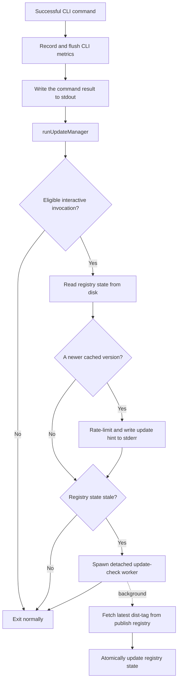
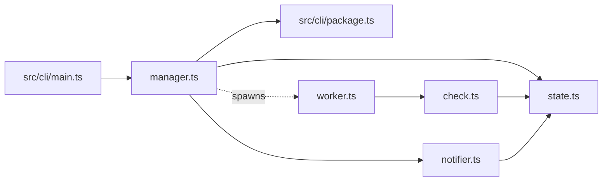

# CLI Update Notifications

This module lets an interactive `lynx-simulator` CLI invocation tell the user
when a newer published version is available. It never updates the package
automatically, changes a command result, or waits for a network request.

When an update is available, the next eligible command writes this hint to
stderr:

```text
A new Lynx Simulator version is available: 1.1.0 → 1.2.0
Update with: npm install -g @lynx-js/lynx-simulator@latest
```

Interactive terminals render the product name in bold, the latest version in
bold bright blue, and the update command underlined. Color output automatically
falls back to plain text when stderr does not support colors or when `NO_COLOR`
or `NODE_DISABLE_COLORS` is set.

## Flow



The worker is detached and unreferenced, so it can outlive the main CLI
process. The current command never waits for its registry request.

## Policy

- Run only after a successful command has written its normal stdout result.
- Skip help, version, non-TTY, CI, and test invocations.
- Skip when `LYNX_SIMULATOR_UPDATE_CHECK_DISABLED` or `NO_UPDATE_NOTIFIER` is
  set.
- Refresh registry state at most once per `UPDATE_REGISTRY_TTL_MS` (3 days).
- Show the same available version at most once every `UPDATE_NOTIFICATION_INTERVAL_MS` (1 day).
- Ignore registry, state-file, and worker errors so they cannot alter CLI
  output or exit status.
- Use the package's configured publish registry and its `latest` dist-tag.
  This update check is separate from CLI metrics and sends no metrics payload.

## Persistent state

State is stored under `~/.lynx-simulator/updates`.

| File            | Contents                                                                     |
| --------------- | ---------------------------------------------------------------------------- |
| `registry.json` | Last registry-check attempt time and the latest version previously returned. |
| `notice.json`   | The version most recently shown to the user and its notification time.       |

Writes use a temporary file followed by rename, preventing another concurrent
CLI process from reading partially written JSON.

## Files



| File          | Responsibility                                                                                                         |
| ------------- | ---------------------------------------------------------------------------------------------------------------------- |
| `manager.ts`  | CLI-facing coordinator: applies eligibility policy, reads state, invokes notification, and schedules a refresh worker. |
| `notifier.ts` | Compares versions and writes the rate-limited stderr notice.                                                           |
| `check.ts`    | Fetches the registry `latest` metadata with a timeout and persists the result.                                         |
| `worker.ts`   | Minimal detached-process entry point for running a registry refresh.                                                   |
| `state.ts`    | Defines persistent state, validates JSON shapes, implements freshness checks, and performs atomic writes.              |

## Testing

Run the focused tests from the repository root:

```bash
pnpm --filter @lynx-js/lynx-simulator run test -- --run src/cli/update/__tests__/manager.test.ts
```
